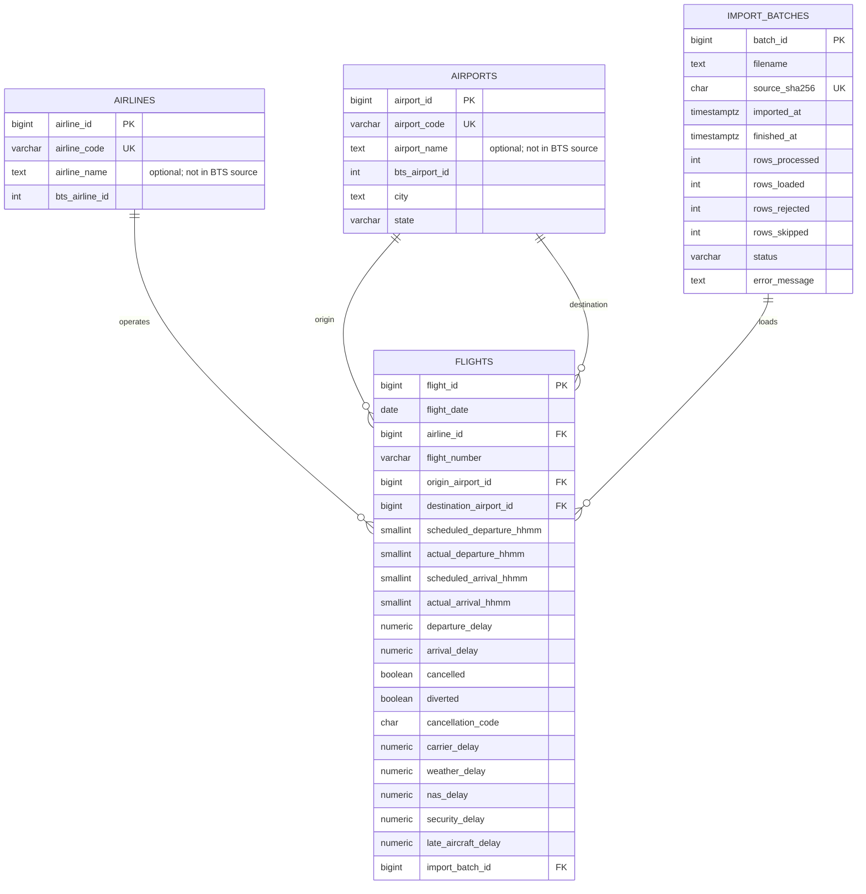

# FlightInsight — ER model (Stage 3)

The relational model is based on BTS On-Time data for January–March 2025.
The schema of record is `database/schema.sql`.

## Design decisions

- **Surrogate PKs** (`airline_id`, `airport_id`, `flight_id`, `batch_id`) are stable internal identifiers. Source codes are separate natural/business identifiers.
- **Airlines and airports are lookup tables**, not repeated names and metadata in `flights`. One airport is referenced twice with distinct roles: origin and destination. This avoids duplication of descriptive data, consistent with 3NF design.
- **`airline_name` and `airport_name` are nullable.** The verified BTS columns provide reporting codes and city/state but not necessarily official names. Names will only be loaded from a verified reference source.
- **BTS HHMM fields are stored as `SMALLINT`.** Values include `2400`; this is not a PostgreSQL `TIME`. The source has local clock times, not unambiguous UTC timestamps. Presentations will format values as HH:MM, treating 2400 as midnight of the following day where relevant.
- **Signed delays** (`departure_delay`, `arrival_delay`) retain negative values; reason-specific delays are nonnegative or NULL. Cancelled and diverted flights are handled separately when calculating punctuality KPIs.
- **Source-level uniqueness** of a scheduled flight is initially enforced by `(flight_date, airline_id, flight_number, origin_airport_id, destination_airport_id, scheduled_departure_hhmm)`. The six source fields were unique and complete in each of the three analyzed files, but the rule still needs validation before expanding to future years.
- **`import_batches.source_sha256` is unique**, and the flights unique constraint is an additional safeguard against duplicate import. An interrupted import must use a database transaction; batch statuses alone do not guarantee atomicity. ETL implementation is planned in Stage 4.
- **Indexes** support airline, origin/destination airport and date filters; the unique index already has `flight_date` as its leftmost column. We will validate performance using `EXPLAIN ANALYZE` in Stage 5, rather than adding unmeasured indexes.

## Relations

1. `AIRLINES (1) -> (N) FLIGHTS`
2. `AIRPORTS (1) -> (N) FLIGHTS` as the **origin** airport
3. `AIRPORTS (1) -> (N) FLIGHTS` as the **destination** airport
4. `IMPORT_BATCHES (1) -> (N) FLIGHTS`

`import_batches` tracks file provenance and import statistics. It is a system-level entity, not a real-world airport/flight relationship.

## Boundaries

The design is initially normalized around these entities. Stage 3 does **not** include populated data, a REST API, or a dashboard. Those components are separate implementation stages.
